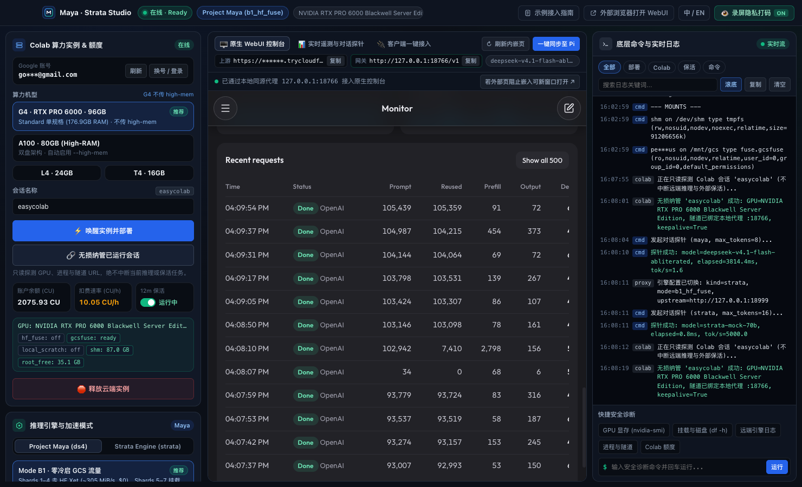
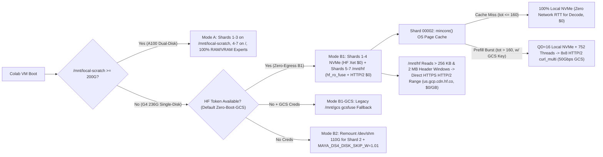

# colab-maya-ds4-256g · Maya · Strata Studio

**简体中文** | [English](./README_EN.md)

在 Google Colab **G4（`NVIDIA RTX PRO 6000 Blackwell · 96 GB` 显存 + `176.9 GiB` 系统内存，`sm_120`）** 与 **A100 High-RAM（`80 GB`，`sm_80`）** 上部署并驾驭 748B 开源旗舰 MoE 模型 **DeepSeek-V4.1-Flash-1017（`Mix-256G` / `abliterated-256g`）**，配套零冷启 GCS 流量加速引擎与跨平台桌面工作台 **Maya · Strata Studio**。

项目整合了 [Project Maya (`maya-ds4` `v1.1.56`)](https://github.com/mw00/project-maya) 预编译 CUDA 运行时、**Mode B1 双模 HTTP/2 加速管线**、`hf_ro_fuse` 只读 FUSE3 文件系统、`cloudflared` HTTPS 公网隧道、12 分钟 Jupyter 内核保活，以及零外部依赖的 **三栏式桌面与 Web 控制工作台**（macOS 原生 Universal `MayaStudio.app` + Windows / Linux 通用 Python 控制面）。



> **设计即安全（Security by Design）：** 仓库内不包含任何真实的 GCP 服务账号私钥、GCS Bucket 名称、Hugging Face Token、公网隧道域名或本机个人路径。所有凭据严格存放在 `~/.config/maya-gcs/`（Git 仓库之外），推送前可执行 `python3 scripts/audit_secrets.py` 进行离线零泄漏自检。

---

## 使用经过鉴权的公网入口与本地同源网关

当你通过 Cloudflare Tunnel（`https://*.trycloudflare.com`）把云端 `96 GB` 显存暴露为公网入口时，未设置鉴权密钥的隧道容易被互联网扫描器探测并消耗计算额度。**Maya · Strata Studio** 提供了一套完整的公网鉴权与本地零配置透明代理闭环：

1. **公网网关密钥保护 (`maya-api-key`)**：
   - 在 Studio 左下角 **「🔐 外部凭据状态 -> Maya 公网网关密钥 (maya-api-key)」** 中填入自定义密钥或点击 **「🎲 随机生成」**，密钥将以 `0600` 权限保存在本机 `~/.config/maya-gcs/maya-api-key`。
   - 部署时（或通过环境变量 `MAYA_API_KEY` / `MAYA_API_KEY_FILE`），脚本与控制面将把该密钥注入远端 `/content/project-maya/maya-ds4.json`（文件权限 `0600`，不在命令行进程参数中暴露明文）。远端 `maya.py` / `serve/server.py` 会自动对 `/v1/*`、`/metrics` 与管理接口强制校验 `Authorization: Bearer <key>` 或 `x-api-key`。
   - 外部客户端直接请求公网隧道时，也必须在请求头中携带对应密钥；`keepalive_colab.sh` 与 Studio 的直连同步同样会自动读取 `~/.config/maya-gcs/maya-api-key`。
2. **本地同源透明反向代理 (`127.0.0.1:18766`)**：
   - Studio 启动后自动在本地监听 `http://127.0.0.1:18766`，将远端 Maya `:8000` 或 Strata 节点无损代理至本机同源入口：既解决了浏览器 `<iframe>` 内嵌跨域问题，又会自动在出站请求头注入本地保存的 `maya-api-key` 或 `strata-api-key`。
   - 将 **Pi**、**Cursor**、**Claude Code** 或本地脚本指向 `http://127.0.0.1:18766/v1`，即可在本机免暴露远程密钥的同时无缝接入云端大模型。
3. **已有 `easycolab` 会话无损热纳管**：
   - 如果你此前已通过命令行启动了 `easycolab` 实例（无论远端是否设置 `api_key`），在 Studio 中点击 **「🔗 无损纳管已运行会话」** 即可通过单次只读探测自动获取 GPU 型号、`/mnt/hf` 与 `/mnt/local-scratch` 挂载状态、`cloudflared` 隧道地址以及外部 `keepalive_colab.sh` 保活状态，**绝不重启推理进程，也不打断现有服务**。

---

## 核心特性

1. **Mode B1-Pure 零云存储默认架构 + 可选同区 GCS 双模突发加速**
   - **`Shards 1–4` 直走 Hugging Face Xet (`~305 MiB/s`, `$0`)**：直接写入云端实例本地 NVMe，彻底绕过 DriveFS 阻塞与按 GB 计费的启动期 GCS 出网流量。
   - **`Shards 5–7` 挂载 `/mnt/hf` (`hf_ro_fuse` FUSE3 + HTTPS HTTP/2 Range)**：大于 `256 KB` 的读取与 `2 MB` 头部窗口直连 HF CDN，零本地落盘且 `$0/GB` 流量费。
   - **`Shard 00002` 默认纯本地零云存储（`Mode B1-Pure`）+ 可选同区 GCS 突发加速（`Mode B1`）**：默认启用 `MAYA_S2_GCS_DISABLE=1`，`Shard 00002` 与低并发 Decode（`~42–66 tok/s`）100% 走本地 NVMe，**零云存储月租、零跨区流量费**；仅在配置了与 Colab 实例**同单区域**的 GCS 桶且显式切换到 `Mode B1` 时，才对高并发 Prefill 突发（`tot > 160`）启用 `752 线程 -> 8x8 HTTP/2 curl_multi` 加速（若启用可选 GCS 桶，请务必选择 `us-central1` / `us-east4` 等单区域桶，切勿选 `us` Multi-Region 以防跨区出站计费）。
   - 提供 **5 种部署模式一键切换**：`Mode B1-Pure`（**默认推荐**，`MAYA_S2_GCS_DISABLE=1`，完全零 GCS 依赖）、`Mode B1`（可选同单区域 GCS 突发加速）、`Mode A`（A100 双盘直读）、`Mode B1-GCS`、`Mode B2`（`/dev/shm` `110G` 内存盘无凭据兜底）。

2. **EasyColab 风格三栏式云端推理工作台（原生 macOS `.app` + 跨平台 WebUI）**
   - **顶部全局栏**：实时显示引擎在线徽标、当前引擎 (`Project Maya` / `Strata Engine`)、GPU 型号、`示例接入指南`、外部浏览器直开、`中 / EN` 实时切换、以及 **录屏隐私打码 (`👁️ ON/OFF`)**（一键遮蔽邮箱、Bucket 名称与 `*.trycloudflare.com` 子域名）。在 `MayaStudio.app` 原生壳（`?shell=macos`）下自动为左侧红绿灯按钮预留安全边距。
   - **左栏（算力实例与引擎模式）**：Google Colab OAuth 账号管理、`G4 / A100 / L4 / T4` 机型选择（内置 `SINGLE_SHAPE_GPUS` 防呆，`G4` 绝不误传 `--high-mem`）、`⚡ 唤醒实例并部署` / `🔗 无损纳管已运行会话`、真实 **CU 余额 / 小时扣费速率** 监控、`12m 保活`开关、二次确认防误触释放实例，以及 **Project Maya / Strata Engine** 分段切换器。
   - **中栏（原生控制台 / 实时遥测 / 客户端一键接入）**：通过 `127.0.0.1:18766` 同源嵌入远端 WebUI、6 步可视化部署流水线、`Prefill / Decode / VRAM 命中率` KPI 看板与最近请求表、`/v1/chat/completions` 探针，以及一键同步 `~/.pi/agent/models.json` 与 `pi-web`（`127.0.0.1:30141`）。
   - **右栏（底层命令与 SSE 实时日志）**：实时订阅 `/api/studio/logs/stream`，支持分类过滤（`全部 / 部署 / Colab / 保活 / 命令`）、关键词搜索，以及 `nvidia-smi`、`df -h`、远端引擎日志、进程与隧道、Colab 额度等快捷诊断芯片与自定义命令执行。

---

## 架构与存储加速拓扑

`scripts/start_g4_256g.sh` 会根据探测到的 Colab VM 磁盘拓扑与用户提供的凭据自动选择最优执行路径：



---

## 实测硬件与吞吐性能对比

| 场景方案 | GPU 与宿主机配置 | 模型与存储分布 | 冷启动耗时 | Prefill 吞吐 | Decode 吞吐（开启 `DSpark`） |
| :--- | :--- | :--- | :--- | :--- | :--- |
| **G4 Mode B1（零冷启 GCS + 双模生产架构）** | RTX PRO 6000 Blackwell (`96 GB`, `600 W`) + EPYC 9B45 (`48T`, `176.9 GiB` DDR5) | `Mix-256G`（`6,099–6,155` VRAM + `9,589–9,645` RAM 专家，`disk_gb=0.0`，`Shards 1–4` HF Xet `~305 MiB/s` 落 NVMe，`5–7` `/mnt/hf` HTTP/2，仅 `>160` 突发走 GCS） | 引擎加载约 **`11.6–15.4 分钟`**（启动阶段 `0 GB` GCS 出网） | 冷启 78K–80K 达 **`391.7–449.1 tok/s`**；313 轮 Agent 会话均值 **`531 tok/s`**（突发可达 `546.7–5,596.9 tok/s`） | 冷启基准中位 **`42.02 tok/s`**（热态 `46.64`，峰值 `57.7 tok/s`）；真实 Agent 会话中位 **`65.95 tok/s`**（P90 达 **`97.42 tok/s`**） |
| **G4 Mode B2（单盘 `/dev/shm` 兜底模式）** | RTX PRO 6000 Blackwell (`96 GB`) | `Mix-256G` + `110G /dev/shm` 放 `Shard 00002`，跳过 `6.7%` 冷门磁盘专家（`MAYA_DS4_DISK_SKIP_W=1.01`） | 约 `15 分钟` | 约 `142 tok/s`（`DS4_PROMPT_PICK=length:65536`） | 最高 **`48.7 tok/s`** |
| **A100 High-RAM（`128g` 实测 / `256g` Mode A）** | A100-SXM4 (`80 GB`, `sm_80`) + `12 vCPU` Xeon (`167.1 GiB` RAM) + 双磁盘（可用 `~585 GB`） | `128g` 已实测；`Mode A` 将 `Shards 1–3`（`~183 GiB`）放入 `/mnt/local-scratch` 实现 `100%` RAM/VRAM 常驻，无需 `LD_PRELOAD` | 约 `15–18 分钟` | `128g` 均值 `455 tok/s`（`740–1,453 tok/s`）；`256g` 预期 `450–900 tok/s` | `128g` 均值 `66.9 tok/s`（注：`128g` 触发循环保护频率高于 `256g`） |

关于实战中遇到的八类典型坑位排查与调优复盘（`DriveFS` `D` 状态死锁、单盘爆盘、`gcsfuse` `5.1x` 读放大、`nvme_card-pd` `1,860 IOPS` 饱和、`DS4_RECENT=0` 陷阱、`65536` 输出截断、`--vision on` 空闲 `0 MiB` 显存、`24 小时` 重建与 `Error 530` 恢复），详见完整工程复盘文档：[docs/g4-vs-a100-748b-retrospective.md](./docs/g4-vs-a100-748b-retrospective.md)。

---

## 仓库目录结构

```text
.
├── .github/workflows/build-macos.yml        # GitHub Actions 离线安全审计 + Universal MayaStudio.app 自动打包工作流
├── .gitignore                               # 严禁提交任何真实密钥、Token、Bucket 名称及打包产物
├── LICENSE                                  # MIT License + 上游 mw00/project-maya 署名
├── README.md                                # 简体中文主文档
├── README_EN.md                             # English Documentation
├── SKILL.md                                 # 供 Coding Agent 复用的技能规范与调优参考
├── docs/
│   ├── studio-preview.png                   # 工作台全功能脱敏预览图
│   └── g4-vs-a100-748b-retrospective.md     # A100 vs G4 748B MoE 全流程脱敏工程复盘
├── macos_app/
│   ├── MayaStudioApp.swift                  # 无需 Xcode 的纯 AppKit + WKWebView 原生 macOS 客户端壳
│   └── build_macos_app.sh                   # 一行命令生成矢量图标、Universal 二进制与 ad-hoc 签名脚本
├── src/
│   ├── hf_ro_fuse.c                         # /mnt/hf 只读 FUSE3 文件系统 (直连 HF CDN HTTP/2 Range)
│   └── gcs_tls_pread.c                      # LD_PRELOAD 双模 HF/GCS + 本地 NVMe 预读加速 C 源码
├── scripts/
│   ├── deploy_from_mac.sh                   # 通过 colab-cli 一键上传运行包、凭据并拉起远端引导
│   ├── start_g4_256g.sh                     # 自适应 Mode A / Mode B1 / Mode B2 云端启动脚本
│   ├── keepalive_colab.sh                   # 12 分钟 Jupyter 内核防休眠保活 + 隧道 URL / 密钥自动同步
│   ├── launch_studio.sh                     # 跨平台工作台启动脚本 (--web / --daemon / --port)
│   ├── install_skill.sh                     # 一键安装为可复用 Agent Skill
│   └── audit_secrets.py                     # 离线密钥、PII 与 tar 元数据零泄漏审计脚本
├── studio/
│   ├── __init__.py
│   ├── __main__.py                          # python3 -m studio 入口 (127.0.0.1:18765 + 同源代理 18766)
│   ├── config_store.py                      # ~/.config/maya-gcs/ 凭据存储、模式目录与 SSE 日志总线
│   ├── colab_manager.py                     # Colab OAuth、G4 单规格防呆、一键部署与只读无损纳管
│   ├── engine_proxy.py                      # 同源反向代理、Bearer 密钥注入与 OpenAI /v1 网关 (:18766)
│   ├── server.py                            # 零依赖 Python ThreadingHTTPServer 控制面 API + SSE (:18765)
│   └── static/
│       ├── index.html                       # 三栏式深色专业工作台界面
│       ├── styles.css                       # 暗色主题 (#0B0F17 / #111826) 与 macOS 安全边距适配
│       └── app.js                           # 零构建 ES6 控制器、实时遥测看板、SSE 日志流与隐私打码
└── resources/
    ├── maya-g4-runtime.tar.gz               # 预编译 sm_120 maya-ds4 + serve/ + v1.1.56 tools/
    ├── maya-a100-sm80-build.tar.gz          # 预编译 sm_80 maya-ds4 (适配 A100 High-RAM)
    ├── pack-meta-256g.tar.gz                # 预打包 Mix-256G pack index、Engram 与 tokenizer 元数据
    ├── maya-ds4.json                        # G4 生产级配置文件 (DSpark + Vision + Blackwell 参数)
    ├── maya-api-key.example                 # 公网网关鉴权密钥占位模板
    ├── gcs-key.json.example                 # GCP 服务账号 JSON 占位模板
    ├── gcs-bucket.example                   # GCS Bucket 名称占位模板
    └── hf-token.example                     # Hugging Face Token 占位模板
```

---

## 全平台安装与快速开始

### 0. 准备工作与外部凭据放置（推荐）

所有敏感凭据统一存放在仓库外的 `~/.config/maya-gcs/` 目录中：

```bash
mkdir -p ~/.config/maya-gcs
chmod 700 ~/.config/maya-gcs

# 1. Hugging Face Token（默认推荐 Mode B1-Pure 纯 HF 零云存储所需唯一凭据）
echo "hf_your_huggingface_token" > ~/.config/maya-gcs/hf-token

# 2. 可选：同单区域 GCS 服务账号与桶名（仅切换到 Mode B1 启用 >160 突发加速时使用；请选与 Colab VM 同单区域，切勿用 us Multi-Region；CLI 部署需显式 MAYA_S2_GCS_DISABLE=0）
cp /path/to/your-gcs-service-account.json ~/.config/maya-gcs/gcs-key.json
echo "your-single-region-gcs-bucket" > ~/.config/maya-gcs/bucket

# 3. 可选：公网网关鉴权密钥（也可稍后在 Studio 界面点击“随机生成”）
echo "sk-maya-your-strong-random-key" > ~/.config/maya-gcs/maya-api-key

chmod 600 ~/.config/maya-gcs/*
```

> 请勿将真实凭据提交进 `resources/`。`deploy_from_mac.sh` 与 Studio 会按「环境变量（`MAYA_GCS_KEY_FILE` / `MAYA_GCS_BUCKET` / `MAYA_HF_TOKEN_FILE` / `MAYA_API_KEY_FILE`） -> `~/.config/maya-gcs/` -> 本地 `.gitignore` 忽略的 `resources/`」顺序自动读取。

---

### macOS 原生客户端（`MayaStudio.app`）

系统要求：**macOS 13.0+**，安装有系统 `swiftc`（仅需 Command Line Tools：`xcode-select --install`，**无需安装完整 Xcode**）与 Python 3.9+。

#### 方式一：本地一行命令编译运行（推荐，无 Gatekeeper 隔离拦截）

```bash
git clone https://github.com/peterhon168/colab-maya-ds4-256g.git
cd colab-maya-ds4-256g
bash macos_app/build_macos_app.sh
codesign --verify --deep --strict MayaStudio.app
open MayaStudio.app
```

- **智能复用与安全退出**：`MayaStudio.app` 启动时会先探测 `127.0.0.1:18765`，如果已有 Studio 服务在运行则直接复用；否则在后台自动拉起 `python3 -m studio --host 127.0.0.1 --port 18765 --proxy-port 18766 --auto-attach`。关闭 `.app` 时**只会终止它自己启动的子进程**，绝不误杀外部守护进程、本地独立服务、`keepalive_colab.sh` 或远端 Colab 实例。
- **独立迁移**：编译脚本会自动把干净的 `studio/`、`scripts/`、`src/` 与脱敏 `resources/` 打包进 `Contents/Resources/`，可直接拖入 `/Applications/MayaStudio.app` 任意移动运行，不依赖源码目录或硬编码个人路径。

#### 方式二：从 GitHub Releases / Actions 下载预编译通用版

1. 前往 **[GitHub Releases](../../releases)** 或 **[Actions](../../actions/workflows/build-macos.yml)** 下载最新 `MayaStudio-macOS-Universal.zip`（支持 Apple Silicon `arm64` 与 Intel `x86_64` 双架构）。
2. 解压后将 `MayaStudio.app` 拖入 `/Applications`。由于预编译包未经过 Apple Developer ID 公证，首次打开如提示 *“无法验证开发者 / 已损坏”*，请在终端执行一次解除隔离属性：

```bash
xattr -cr /Applications/MayaStudio.app
```

---

### Windows / Linux 跨平台 Web 工作台（零第三方依赖）

工作台后端 `studio/` 完全基于 Python 标准库编写，无需 `pip install` 任何第三方包，在 Windows（WSL / 原生 Python 3.9+）、Linux 与 macOS 上均可直接启动：

```bash
git clone https://github.com/peterhon168/colab-maya-ds4-256g.git
cd colab-maya-ds4-256g

# 直接通过 Python 启动控制面板 (127.0.0.1:18765) 与本地同源代理 (127.0.0.1:18766)
python3 -m studio --host 127.0.0.1 --port 18765 --proxy-port 18766 --auto-attach
```

在 macOS / Linux 下也可使用跨平台包装脚本：

```bash
bash scripts/launch_studio.sh                 # macOS 默认启动 MayaStudio.app（无包则回退 --web）
bash scripts/launch_studio.sh --web           # 强制启动 Python 控制面并在浏览器打开 http://127.0.0.1:18765
bash scripts/launch_studio.sh --daemon        # 后台守护运行并立即返回
bash scripts/launch_studio.sh --port 18765    # 指定自定义控制面端口（已监听则自动复用）
```

> **Strata Engine 节点热挂载：** 在界面左侧将引擎切换至 **`Strata Engine (strata)`**，即可直接接入任意局域网或公网 Strata 节点（例如 `http://192.168.x.x:18181` 或 `https://<random-subdomain>.trycloudflare.com`），并通过 `http://127.0.0.1:18766` 同源嵌入原生 WebUI 与 `/v1/*` 网关。

---

### 命令行一键部署与 12 分钟防休眠保活

如果你偏好纯终端或无头服务器流水线：

```bash
# 1. 创建 Colab GPU 运行时（注意：G4 为单规格机型，切勿传 --high-mem；仅 A100 传 --high-mem）
colab new -s easycolab --gpu G4

# 2. 上传预编译运行包、凭据并启动 Mode A / B1 / B2 自适应部署 + 12 分钟后台保活
bash scripts/deploy_from_mac.sh easycolab
```

> **G4 单规格提醒：** `colab-cli` 对 `--high-mem` 会发送 `shape=hm`，Colab 会对 G4 返回 `HTTP 400: Backend rejected accelerator 'G4'`。请仅在创建 `A100` 时使用 `colab new -s easycolab --gpu A100 --high-mem`。

查看远端引擎加载进度与验证 `/metrics`：

```bash
colab exec -s easycolab << 'EOF'
!tail -n 25 /content/project-maya/maya-ds4.log
!grep -hoE "https://[a-zA-Z0-9-]+\.trycloudflare\.com" /content/project-maya/cloudflared.log /tmp/cloudflared.log 2>/dev/null | tail -n 1
EOF
```

当日志出现 `ready: http://127.0.0.1:8000/v1` 后，验证核心遥测指标：

```bash
colab exec -s easycolab << 'EOF'
import json, urllib.request
m = json.loads(urllib.request.urlopen("http://127.0.0.1:8000/metrics", timeout=10).read())
print("images:", m["engine"]["images"], "dspark:", m["engine"]["dspark"], "ram_experts:", m["engine"]["ram_experts"])
if m.get("tiers"):
    print("disk_gb:", m["tiers"]["now"]["disk_gb"])
EOF
```

如果本机存在 OpenAI 兼容客户端配置 `~/.pi/agent/models.json`，`keepalive_colab.sh` 会自动更新其 `baseUrl`、`apiKey`（若存在 `~/.config/maya-gcs/maya-api-key`）、`maxTokens`（`65536`）及多模态输入标识 `["text", "image"]`，并可通过 `PI_MODELS_JSON`、`PI_PROVIDER_KEY` 与 `PI_WEB_URL` 环境变量自定义。

---

### 安装为 Coding Agent 复用技能（Skill）

```bash
bash scripts/install_skill.sh
```

脚本会将工具包同步至 `~/.gemini/config/skills/colab-maya-ds4-256g`，并自动软链至 `~/.agents/skills`、`~/.codex/skills` 与 `~/.claude/skills`（同时保护已有凭据不被覆盖）。

---

## 隐私与安全建议

1. **录屏 / 截图隐私打码开关**：Studio 右上角提供全局 **「👁️ 录屏隐私打码 (`ON / OFF`)」** 开关，默认开启，自动对界面和实时日志中的 Google 账号邮箱（`go***@gmail.com`）、GCS Bucket 名、内部 VM ID（`gpu-g4-...`）及 `*.trycloudflare.com` 公网隧道域名进行脱敏遮蔽，防止直播或截图分享时算力被他人蹭用。
2. **公网推理鉴权密钥**：强烈建议在公网暴露场景下设置 `maya-api-key`；通过 Studio 本地代理 `http://127.0.0.1:18766/v1` 调用时无需手动暴露远程密钥。
3. **本地凭据隔离与打包过滤**：
   - 凭据集中存放于 `~/.config/maya-gcs/`（目录 `0700`，文件 `0600`）。
   - `macos_app/build_macos_app.sh` 构建时显式剔除 `gcs-key.json`、`gcs-bucket`、`hf-token`、`maya-api-key`、`strata-api-key`、`*.key`、`*.pem`、`.env*`、`.DS_Store` 等敏感文件，并在签名前二次扫描确认零泄漏。
4. **推送前离线安全审计**：每次提交或发布前运行：

```bash
python3 scripts/audit_secrets.py
```

脚本会离线扫描所有工作区文件以及 `resources/*.tar.gz` 压缩包内的每一条内容与文件头（检查 Token、私钥、OAuth 令牌、服务账号邮箱、隧道子域名、个人 `/Users/<name>` 路径及非 `root:root` tar 头），确认输出 `Findings count: 0`。

---

## 免责声明与合规说明 (Disclaimer)

- **非官方独立项目**：本项目是社区开发的部署工具集与独立本地工作台，**与 Google LLC、Google Colab、DeepSeek、Project Maya 原作者或 Hugging Face 无任何隶属、赞助或官方背书关系**。
- **平台服务条款（ToS）提示**：
  - 本项目面向已订阅 **Google Colab Pro / Pro+ / Google AI Ultra**（拥有自购 Compute Units 计算单元）的开发者与研究者合理自用。
  - **请勿**在 Colab 免费层滥用后台长连接，严禁用于加密货币挖矿、批量多号滥用或违规算力转售。使用第三方 CLI 连接云端运行时可能受平台策略调整影响，相关账号风险请由使用者自行评估并承担。
- **模型与上游组件许可证**：
  - 本仓库**不包含也不分发任何模型权重文件**。模型分片均在运行时由用户凭自身合法权限直接从 Hugging Face 或个人 GCS 桶拉取，使用前请确认遵守对应模型与工具的上游开源许可协议。

---

## 致谢 (Acknowledgements)

感谢以下开源项目、研究工作与基础设施：

- [`mw00/project-maya`](https://github.com/mw00/project-maya) — 核心高性能异构推理引擎与 `serve/server.py`
- [`wy51ai/easycolab`](https://github.com/wy51ai/easycolab) — 三栏式云端 AI 工作台交互设计、原生桌面封装与安全网关实践灵感来源
- [`google-colab-cli`](https://pypi.org/project/google-colab-cli/) — Google Colab OAuth 与无头会话交互桥接
- [`cloudflared`](https://github.com/cloudflare/cloudflared) & **Hugging Face Xet / CDN** — 低成本高带宽分片分发与临时 HTTPS 加密隧道

---

## License

- 仓库脚本、工作台源码、`docs/` 与自研 C 源码（`src/hf_ro_fuse.c`、`src/gcs_tls_pread.c`）：基于 [MIT License](./LICENSE) 开源发布。
- `resources/` 中随附的 `Project Maya` (`v1.1.56`) 预编译组件、`serve/` 与打包工具归属于上游 [`mw00/project-maya`](https://github.com/mw00/project-maya)（MIT License）。
