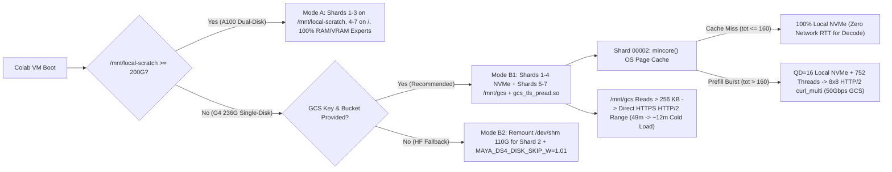

# colab-maya-ds4-256g

Deploy **DeepSeek-V4.1-Flash-1017 (`Mix-256G` / `abliterated-256g`, 748B MoE)** on Google Colab **G4 (`NVIDIA RTX PRO 6000 Blackwell Server Edition 96GB`, `sm_120`)** or **A100 High-RAM (`80GB`, `sm_80`)** using [Project Maya (`maya-ds4` `v1.1.56`)](https://github.com/mw00/project-maya), complete with pre-built CUDA binaries, pre-packed metadata, dual-regime HTTP/2 GCS acceleration, Cloudflare Tunnel exposure, and 12-minute Jupyter kernel keepalive.

> **Security by design:** No real GCP service account keys, GCS bucket names, Hugging Face tokens, private tunnel URLs, or personal machine paths are included in this repository. Put your credentials in `~/.config/maya-gcs/` (outside Git) and run `python3 scripts/audit_secrets.py` before pushing any fork.

---

## Architecture Overview

`scripts/start_g4_256g.sh` automatically selects one of three storage & execution modes based on the attached Colab VM hardware and provided credentials:



---

## Measured Hardware & Performance Summary

| Scenario | GPU & Host | Model & Storage Layout | Cold Load Time | Prefill Speed | Decode Speed (with `DSpark`) |
| :--- | :--- | :--- | :--- | :--- | :--- |
| **G4 Mode B1 (GCS Dual-Regime, Production)** | RTX PRO 6000 Blackwell (`96 GB`, `600 W`) + EPYC 9B45 (`48T`, `176.9 GiB` DDR5) | `Mix-256G` (`6,099–6,155` VRAM + `9,589–9,645` RAM experts, `disk_gb=0.0`, `Shards 1–4` NVMe, `5–7` GCS HTTP/2) | `~11.6–15.4 min` engine load (`~21–24 min` fresh empty VM end-to-end) | **`391.7–449.1 tok/s`** cold 78K–80K; **`531 tok/s`** mean (`546.7–5,596.9 tok/s` bursts) in 313-round Agent workload | **`42.02 tok/s`** cold benchmark median (`46.64 tok/s` warmed, `57.7 tok/s` peak); **`65.95 tok/s`** median (`P90 97.42 tok/s`) in real Agent sessions |
| **G4 Mode B2 (Single-Disk `/dev/shm` Fallback)** | RTX PRO 6000 Blackwell (`96 GB`) | `Mix-256G` with `110G /dev/shm` for `Shard 00002`, skips `6.7%` cold disk experts (`MAYA_DS4_DISK_SKIP_W=1.01`) | `~15 min` | `~142 tok/s` (`DS4_PROMPT_PICK=length:65536`) | Up to **`48.7 tok/s`** (after `0.97 -> 48.7` fix) |
| **A100 High-RAM (`128g` Measured / `256g` Mode A)** | A100-SXM4 (`80 GB`, `sm_80`) + `12 vCPU` Xeon (`167.1 GiB` RAM) + dual disks (`~585 GB` free) | `Mix-128G` measured; `Mode A` places `Shards 1–3` (`~183 GiB`) on `/mnt/local-scratch` for `100%` `Mix-256G` RAM/VRAM residency without `LD_PRELOAD` | `~15–18 min` | `455 tok/s` mean (`740–1,453 tok/s`) on `128g`; `450–900 tok/s` expected on `256g` | `66.9 tok/s` mean on `128g` (note: higher loop-guard frequency on `128g`) |

Detailed troubleshooting notes covering all eight pitfalls (`DriveFS` `D`-state deadlocks, single-disk OOM, `gcsfuse` `5.1x` read amplification, `nvme_card-pd` `1,860 IOPS` saturation, `DS4_RECENT=0` traps, `65536` output clamping, `--vision on` `0 MiB` idle VRAM, and Colab `24h` / `Error 530` recovery) are documented in [docs/g4-vs-a100-748b-retrospective.md](docs/g4-vs-a100-748b-retrospective.md).

---

## Repository Layout

```text
.
├── .gitignore                             # Excludes real keys, tokens, bucket names, and OS junk
├── LICENSE                                # MIT License + upstream mw00/project-maya attribution
├── README.md
├── SKILL.md                               # Agent skill instructions & tuning reference
├── docs/
│   └── g4-vs-a100-748b-retrospective.md   # Full sanitized A100 vs G4 engineering retrospective
├── src/
│   └── gcs_tls_pread.c                    # Extracted LD_PRELOAD dual-regime GCS/NVMe C source
├── scripts/
│   ├── deploy_from_mac.sh                 # One-command uploader & remote bootstrap via colab-cli
│   ├── start_g4_256g.sh                   # Adaptive Mode A / Mode B1 / Mode B2 runtime launcher
│   ├── keepalive_colab.sh                 # 12-min Jupyter kernel keepalive + tunnel URL sync
│   ├── install_skill.sh                   # Installs this folder as a reusable agent skill
│   └── audit_secrets.py                   # Offline secret, PII, and tar header metadata scanner
└── resources/
    ├── maya-g4-runtime.tar.gz             # Prebuilt sm_120 maya-ds4 + patched serve/ + v1.1.56 tools/
    ├── maya-a100-sm80-build.tar.gz        # Prebuilt sm_80 maya-ds4 for A100 High-RAM
    ├── pack-meta-256g.tar.gz              # Pre-built Mix-256G pack index, Engram & tokenizer metadata
    ├── maya-ds4.json                      # Production G4 configuration (DSpark + Vision + Blackwell flags)
    ├── gcs-key.json.example               # Placeholder GCP Service Account JSON template
    ├── gcs-bucket.example                 # Placeholder GCS bucket template
    └── hf-token.example                   # Placeholder Hugging Face token template
```

---

## Quickstart

### 0. Clone Repository

```bash
git clone https://github.com/peterhon168/colab-maya-ds4-256g.git
cd colab-maya-ds4-256g
```

### 1. Place Credentials Outside Git (Recommended)

```bash
mkdir -p ~/.config/maya-gcs
chmod 700 ~/.config/maya-gcs

# Optional for Mode B1 (recommended on G4): same-region GCS service account & bucket name
cp /path/to/your-gcs-service-account.json ~/.config/maya-gcs/gcs-key.json
echo "your-gcs-bucket-name" > ~/.config/maya-gcs/bucket

# Hugging Face read token (for Mode A / Mode B2 or GCS fallback)
echo "hf_your_huggingface_token" > ~/.config/maya-gcs/hf-token

chmod 600 ~/.config/maya-gcs/*
```

> Never commit real credential files into `resources/`. `deploy_from_mac.sh` checks environment variables (`MAYA_GCS_KEY_FILE`, `MAYA_GCS_BUCKET`, `MAYA_HF_TOKEN_FILE` / `HF_TOKEN`), then `~/.config/maya-gcs/`, and finally `.gitignore`-excluded files under `resources/`.

### 2. Provision a Colab Runtime

For **Colab G4 (`RTX PRO 6000 Blackwell 96GB`)**:

```bash
colab new -s easycolab --gpu G4
```

> **Important:** Do **not** pass `--high-mem` with `--gpu G4`. `colab-cli` sends `shape=hm` and Colab rejects it with `HTTP 400: Backend rejected accelerator 'G4'` because G4 already uses the single `Standard` (`176.9 GiB`) machine shape. Only pass `--high-mem` for `A100` (`colab new -s easycolab --gpu A100 --high-mem`).

### 3. Deploy from Your Local Machine

```bash
bash scripts/deploy_from_mac.sh easycolab
```

The script uploads the prebuilt runtime (`~62 MB`), configures Mode A / Mode B1 / Mode B2 automatically, pulls/links `Mix-256G` shards, starts `maya-ds4` + `cloudflared`, and launches `scripts/keepalive_colab.sh` in the background.

If you use a local OpenAI-compatible client config (`~/.pi/agent/models.json`), `keepalive_colab.sh` automatically updates `baseUrl`, `maxTokens` (`65536`), and `input` (`["text", "image"]`) when present, and can also be customized via `PI_MODELS_JSON`, `PI_PROVIDER_KEY`, and `PI_WEB_URL`. If no local config file exists, it still prints the active `https://*.trycloudflare.com` URL and keeps the Colab session alive.

### 4. Monitor Progress & Verify Endpoints

```bash
colab exec -s easycolab << 'EOF'
!tail -n 25 /content/project-maya/maya-ds4.log
!grep -hoE "https://[a-zA-Z0-9-]+\.trycloudflare\.com" /content/project-maya/cloudflared.log /tmp/cloudflared.log 2>/dev/null | tail -n 1
EOF
```

Once `ready: http://127.0.0.1:8000/v1` appears, check `/metrics`:

```bash
colab exec -s easycolab << 'EOF'
import json, urllib.request
m = json.loads(urllib.request.urlopen("http://127.0.0.1:8000/metrics", timeout=10).read())
print("images:", m["engine"]["images"], "dspark:", m["engine"]["dspark"], "ram_experts:", m["engine"]["ram_experts"])
if m.get("tiers"):
    print("disk_gb:", m["tiers"]["now"]["disk_gb"])
EOF
```

---

## Install as a Reusable Coding-Agent Skill

```bash
bash scripts/install_skill.sh
```

This copies the toolkit to `~/.gemini/config/skills/colab-maya-ds4-256g` and symlinks it into `~/.agents/skills`, `~/.codex/skills`, and `~/.claude/skills`.

---

## Pre-Publish Security & Hygiene Audit

Before committing or pushing changes to GitHub, run the offline audit script to verify that no tokens, private keys, GCP emails, live tunnel URLs, local `/Users/<name>` paths, or non-`root` tar headers are present anywhere in tracked files or inside `resources/*.tar.gz`:

```bash
python3 scripts/audit_secrets.py
```

---

## License & Attribution

- Repository scripts, documentation, and `src/gcs_tls_pread.c`: [MIT License](LICENSE).
- Bundled `Project Maya` (`v1.1.56`) runtime binaries, serving layer, and packing tools: upstream [`mw00/project-maya`](https://github.com/mw00/project-maya) (MIT License).
