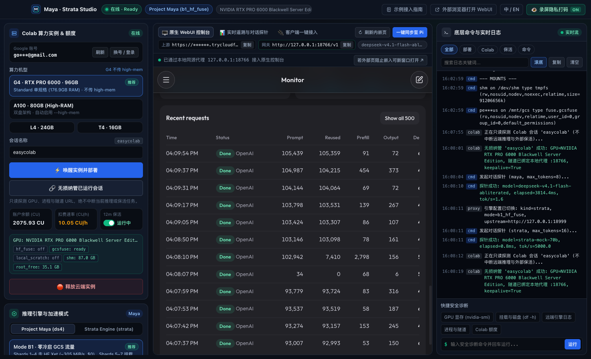
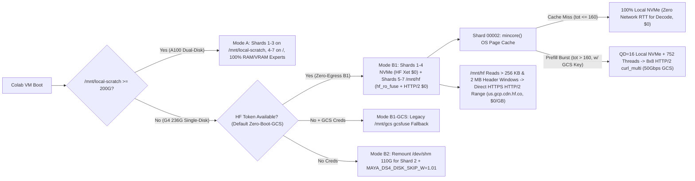

# colab-maya-ds4-256g · Maya · Strata Studio

[简体中文](./README.md) | **English**

Deploy and operate the 748B flagship open-source MoE model **DeepSeek-V4.1-Flash-1017 (`Mix-256G` / `abliterated-256g`)** on Google Colab **G4 (`NVIDIA RTX PRO 6000 Blackwell · 96 GB` VRAM + `176.9 GiB` system RAM, `sm_120`)** and **A100 High-RAM (`80 GB`, `sm_80`)**, complete with a Zero-Boot-GCS acceleration engine and the cross-platform **Maya · Strata Studio** workbench.

This repository bundles the pre-built [Project Maya (`maya-ds4` `v1.1.56`)](https://github.com/mw00/project-maya) CUDA runtime, a **Mode B1 dual-regime HTTP/2 I/O pipeline**, a lightweight read-only FUSE3 filesystem (`hf_ro_fuse`), Cloudflare Tunnel exposure, 12-minute Jupyter kernel keepalive, and a **zero-dependency 3-column desktop & web control plane** (Universal native macOS `MayaStudio.app` + cross-platform Python control plane for Windows and Linux).



> **Security by Design:** No real GCP service account keys, GCS bucket names, Hugging Face tokens, live tunnel subdomains, or personal host paths are stored in this repository. Keep all credentials strictly inside `~/.config/maya-gcs/` (outside Git) and run `python3 scripts/audit_secrets.py` before pushing any commit.

---

## Authenticated Public Entrypoint & Local Same-Origin Gateway

Exposing a 96 GB cloud GPU to the internet over `https://*.trycloudflare.com` without authentication leaves the endpoint vulnerable to scanners and unauthorized compute drain. **Maya · Strata Studio** combines an authenticated public entrypoint with a seamless local reverse proxy:

1. **Authenticated Public Gateway (`maya-api-key`)**:
   - Open **🔐 Credentials -> Maya Public Gateway Key (`maya-api-key`)** in Studio to enter your own key or click **🎲 Randomize**, persisting it with `0600` permissions in `~/.config/maya-gcs/maya-api-key`.
   - During deployment (or via `MAYA_API_KEY` / `MAYA_API_KEY_FILE`), `start_g4_256g.sh` writes `"api_key"` safely into remote `/content/project-maya/maya-ds4.json` (`chmod 0600`) without exposing secrets in process command-line arguments (`ps`). Upstream `maya.py` / `serve/server.py` enforces `Authorization: Bearer <key>` or `x-api-key` on `/v1/*`, `/metrics`, and management routes.
   - `keepalive_colab.sh` and Studio's direct client sync automatically propagate the configured key to `~/.pi/agent/models.json` when using the public tunnel directly.
2. **Local Same-Origin Transparent Reverse Proxy (`127.0.0.1:18766`)**:
   - Studio listens locally on `http://127.0.0.1:18766`, proxying either remote Maya `:8000` or any Strata endpoint under the same local origin. This enables conflict-free `<iframe>` embedding of the native WebUI and automatically injects `Authorization: Bearer <key>` on outbound requests when `maya-api-key` or `strata-api-key` is configured.
   - Point **Pi**, **Cursor**, **Claude Code**, or Python SDK clients at `http://127.0.0.1:18766/v1` for zero-friction local integration without scattering cloud gateway keys across client configs.
3. **Lossless Attach to Active `easycolab` Sessions**:
   - If you already deployed an active session via CLI (with or without an API key configured remotely), click **🔗 Attach Losslessly** (`--auto-attach`). Studio executes a single read-only `colab exec` probe to discover the GPU name, `/mnt/hf` and `/mnt/local-scratch` mount health, `cloudflared` tunnel URL, and external `keepalive_colab.sh` daemon PID, then binds `http://127.0.0.1:18766` immediately without restarting inference.

---

## Core Features

1. **Mode B1-Pure Zero-GCS Default + Optional Same-Region GCS Burst Acceleration**
   - **`Shards 1–4` via Hugging Face Xet (`~305 MiB/s`, `$0`)**: Placed directly on VM local NVMe, eliminating DriveFS `D`-state hangs and boot-time GCS egress costs.
   - **`Shards 5–7` via `/mnt/hf` (`hf_ro_fuse` FUSE3 + HTTPS HTTP/2 Range)**: Reads larger than `256 KB` and `2 MB` header windows go straight to the Hugging Face CDN (`$0/GB` egress, zero local disk footprint).
   - **`Shard 00002` Zero-GCS NVMe Default (`Mode B1-Pure`) + Optional Single-Region GCS Burst (`Mode B1`)**: Enables `MAYA_S2_GCS_DISABLE=1` by default so both `Shard 00002` and decode remain 100% on local NVMe with **$0 GCS storage and $0 egress**. Only when you supply a same-single-region GCS bucket (e.g., `us-central1` / `us-east4` — never `us` Multi-Region to avoid cross-region egress charges) and explicitly select `Mode B1` does `tot > 160` prefill burst across `752` threads (`8x8` HTTP/2 `curl_multi`).
   - **Five One-Click Modes**: `Mode B1-Pure` (**default recommended**, `MAYA_S2_GCS_DISABLE=1`, zero GCS dependency), `Mode B1` (optional single-region GCS burst), `Mode A` (A100 dual-disk), `Mode B1-GCS` (`gcsfuse` fallback), and `Mode B2` (`110G /dev/shm` RAMDisk fallback with zero credentials).

2. **EasyColab-Style Three-Column Workbench (Native macOS `.app` & Cross-Platform WebUI)**
   - **Top Global Bar**: Live status pill, active engine badge (`Project Maya` / `Strata Engine`), GPU chip, Quick Guide modal, external WebUI launcher, live `中 / EN` language switch, and **Screen-Recording Privacy Mask (`👁️ ON/OFF`)** that masks emails (`go***@gmail.com`), bucket identifiers, internal `gpu-*` VM IDs, and `*.trycloudflare.com` subdomains across both UI widgets and live logs. Automatically reserves `78px` left padding for macOS traffic lights when running inside `MayaStudio.app`.
   - **Left Column (Compute & Mode Selection)**: Google Colab OAuth manager, GPU selector (`G4`, `A100`, `L4`, `T4`) with built-in `SINGLE_SHAPE_GPUS` guard so `G4` never sends `--high-mem`, `Provision & Deploy` / `Attach Losslessly`, live **CU balance & hourly burn rate**, `12m Keepalive` toggle, confirmation-guarded instance release, and **Project Maya / Strata Engine** segmented switcher.
   - **Center Stage (Embedded Console, Telemetry & Client Sync)**: Same-origin `<iframe>` for Maya / Strata WebUI via `:18766`, 6-stage deployment pipeline, live KPI grid (`Prefill tok/s`, `Decode tok/s`, `VRAM Hit Rate`, `Requests`, `Queue`), recent requests table, `/v1/chat/completions` probe, and one-click sync to `~/.pi/agent/models.json` + `pi-web` (`127.0.0.1:30141`) plus Cursor / Claude Code / OpenAI SDK snippets.
   - **Right Column (Diagnostics & Live Logs)**: Real-time SSE stream (`/api/studio/logs/stream`), category pills (`All`, `Deploy`, `Colab`, `Keepalive`, `Cmd`), keyword filter, diagnostic presets (`nvidia-smi`, `df -h`, remote logs, processes/tunnels, Colab quota), and custom shell execution.

---

## Architecture Overview

`scripts/start_g4_256g.sh` automatically selects one of the execution modes based on detected VM disk layout and provided credentials:



---

## Measured Hardware & Performance Summary

| Scenario | GPU & Host | Model & Storage Layout | Cold Load Time | Prefill Speed | Decode Speed (with `DSpark`) |
| :--- | :--- | :--- | :--- | :--- | :--- |
| **G4 Mode B1 (Zero-Boot-GCS + Dual-Regime, Production)** | RTX PRO 6000 Blackwell (`96 GB`, `600 W`) + EPYC 9B45 (`48T`, `176.9 GiB` DDR5) | `Mix-256G` (`6,099–6,155` VRAM + `9,589–9,645` RAM experts, `disk_gb=0.0`, `Shards 1–4` NVMe via HF Xet `~305 MiB/s`, `5–7` `/mnt/hf` HTTP/2, GCS for `>160` bursts only) | `~11.6–15.4 min` engine load (`0 GB` boot GCS egress) | **`391.7–449.1 tok/s`** cold 78K–80K; **`531 tok/s`** mean (`546.7–5,596.9 tok/s` bursts) in 313-round Agent workload | **`42.02 tok/s`** cold benchmark median (`46.64 tok/s` warmed, `57.7 tok/s` peak); **`65.95 tok/s`** median (`P90 97.42 tok/s`) in real Agent sessions |
| **G4 Mode B2 (Single-Disk `/dev/shm` Fallback)** | RTX PRO 6000 Blackwell (`96 GB`) | `Mix-256G` with `110G /dev/shm` for `Shard 00002`, skips `6.7%` cold disk experts (`MAYA_DS4_DISK_SKIP_W=1.01`) | `~15 min` | `~142 tok/s` (`DS4_PROMPT_PICK=length:65536`) | Up to **`48.7 tok/s`** (after `0.97 -> 48.7` fix) |
| **A100 High-RAM (`128g` Measured / `256g` Mode A)** | A100-SXM4 (`80 GB`, `sm_80`) + `12 vCPU` Xeon (`167.1 GiB` RAM) + dual disks (`~585 GB` free) | `Mix-128G` measured; `Mode A` places `Shards 1–3` (`~183 GiB`) on `/mnt/local-scratch` for `100%` `Mix-256G` RAM/VRAM residency without `LD_PRELOAD` | `~15–18 min` | `455 tok/s` mean (`740–1,453 tok/s`) on `128g`; `450–900 tok/s` expected on `256g` | `66.9 tok/s` mean on `128g` (note: higher loop-guard frequency on `128g`) |

Detailed troubleshooting notes covering all eight pitfalls (`DriveFS` `D`-state deadlocks, single-disk OOM, `gcsfuse` `5.1x` read amplification, `nvme_card-pd` `1,860 IOPS` saturation, `DS4_RECENT=0` traps, `65536` output clamping, `--vision on` `0 MiB` idle VRAM, and Colab `24h` / `Error 530` recovery) are documented in [docs/g4-vs-a100-748b-retrospective.md](./docs/g4-vs-a100-748b-retrospective.md).

---

## Repository Layout

```text
.
├── .github/workflows/build-macos.yml        # Automated GitHub Actions secret audit + Universal MayaStudio.app CI build
├── .gitignore                               # Excludes real keys, tokens, bucket names, .app bundles, and OS junk
├── LICENSE                                  # MIT License + upstream mw00/project-maya attribution
├── README.md                                # Simplified Chinese homepage
├── README_EN.md                             # English homepage
├── SKILL.md                                 # Agent skill instructions & tuning reference
├── docs/
│   ├── studio-preview.png                   # Privacy-masked workbench hero screenshot
│   └── g4-vs-a100-748b-retrospective.md     # Full sanitized A100 vs G4 engineering retrospective
├── macos_app/
│   ├── MayaStudioApp.swift                  # Xcode-free AppKit + WKWebView native macOS desktop shell
│   └── build_macos_app.sh                   # Single-command CoreGraphics icon + Universal swiftc + codesign builder
├── src/
│   ├── hf_ro_fuse.c                         # Lightweight read-only FUSE3 mount (/mnt/hf) for HF CDN
│   └── gcs_tls_pread.c                      # Extracted LD_PRELOAD dual-regime HF/GCS + NVMe I/O C source
├── scripts/
│   ├── deploy_from_mac.sh                   # One-command uploader & remote bootstrap via colab-cli
│   ├── start_g4_256g.sh                     # Adaptive Mode A / Mode B1 / Mode B2 runtime launcher
│   ├── keepalive_colab.sh                   # 12-min Jupyter kernel keepalive + tunnel URL / key sync
│   ├── launch_studio.sh                     # Cross-platform launcher (--web / --daemon / --port / MayaStudio.app)
│   ├── install_skill.sh                     # Installs this folder as a reusable agent skill
│   └── audit_secrets.py                     # Offline secret, PII, and tar header metadata scanner
├── studio/
│   ├── __init__.py
│   ├── __main__.py                          # python3 -m studio entry point (127.0.0.1:18765 + proxy 18766)
│   ├── config_store.py                      # ~/.config/maya-gcs/ credential store, mode catalog & SSE log broker
│   ├── colab_manager.py                     # Colab OAuth, G4 single-shape guard, deploy & read-only attach
│   ├── engine_proxy.py                      # Same-origin transparent reverse proxy & OpenAI /v1 gateway (:18766)
│   ├── server.py                            # Stdlib ThreadingHTTPServer control plane REST + SSE API (:18765)
│   └── static/
│       ├── index.html                       # EasyColab-style 3-column dark workbench HTML
│       ├── styles.css                       # Dark theme (#0B0F17 / #111826), ?shell=macos safe-area gutter
│       └── app.js                           # Zero-build ES6 controller, live telemetry, SSE logs & privacy mask
└── resources/
    ├── maya-g4-runtime.tar.gz               # Prebuilt sm_120 maya-ds4 + patched serve/ + v1.1.56 tools/
    ├── maya-a100-sm80-build.tar.gz          # Prebuilt sm_80 maya-ds4 for A100 High-RAM
    ├── pack-meta-256g.tar.gz                # Pre-built Mix-256G pack index, Engram & tokenizer metadata
    ├── maya-ds4.json                        # Production G4 configuration (DSpark + Vision + Blackwell flags)
    ├── maya-api-key.example                 # Placeholder Maya gateway API key template
    ├── gcs-key.json.example                 # Placeholder GCP Service Account JSON template
    ├── gcs-bucket.example                   # Placeholder GCS bucket template
    └── hf-token.example                     # Placeholder Hugging Face token template
```

---

## Quickstart Across Platforms

### 0. Stage Credentials Outside Git (Recommended)

```bash
mkdir -p ~/.config/maya-gcs
chmod 700 ~/.config/maya-gcs

# Hugging Face read token (sole required credential for default Mode B1-Pure Zero-GCS / Mode A / Mode B2)
echo "hf_your_huggingface_token" > ~/.config/maya-gcs/hf-token

# Optional for Mode B1 burst acceleration: single-region GCS service account & bucket matching your Colab VM region (never use `us` Multi-Region; CLI requires MAYA_S2_GCS_DISABLE=0)
cp /path/to/your-gcs-service-account.json ~/.config/maya-gcs/gcs-key.json
echo "your-single-region-gcs-bucket" > ~/.config/maya-gcs/bucket

# Optional: public gateway API key to lock down your *.trycloudflare.com endpoint
echo "sk-maya-your-strong-random-key" > ~/.config/maya-gcs/maya-api-key

chmod 600 ~/.config/maya-gcs/*
```

> Never commit real credential files into `resources/`. `deploy_from_mac.sh` and Studio check environment variables (`MAYA_GCS_KEY_FILE`, `MAYA_GCS_BUCKET`, `MAYA_HF_TOKEN_FILE`, `HF_TOKEN`, `MAYA_API_KEY_FILE`, `MAYA_API_KEY`), then `~/.config/maya-gcs/`, and finally `.gitignore`-excluded files under `resources/`.

---

### macOS Native Desktop App (`MayaStudio.app`)

Requires **macOS 13.0+** with Swift CLI (`swiftc` via `xcode-select --install`, no full Xcode project required) and Python 3.9+.

#### Option 1: One-Command Local Build (Recommended, zero Gatekeeper friction)

```bash
git clone https://github.com/peterhon168/colab-maya-ds4-256g.git
cd colab-maya-ds4-256g
bash macos_app/build_macos_app.sh
codesign --verify --deep --strict MayaStudio.app
open MayaStudio.app
```

- **Smart Process Reuse & Safe Exit**: At startup, `MayaStudio.app` probes `127.0.0.1:18765`, reusing an already running Studio daemon or launching one in the background (`--auto-attach`). On quit, `.app` only terminates child processes it spawned itself—external daemons, `keepalive_colab.sh`, and remote Colab VMs remain untouched.
- **Standalone Relocation**: `build_macos_app.sh` embeds sanitized `studio/`, `scripts/`, `src/`, and non-secret `resources/` inside `Contents/Resources/` without hardcoded `/Users/<username>` paths, allowing you to drag `MayaStudio.app` straight into `/Applications`.

#### Option 2: Download Prebuilt Universal Binary from GitHub Releases / Actions

1. Download `MayaStudio-macOS-Universal.zip` from **[GitHub Releases](../../releases)** or **[GitHub Actions](../../actions/workflows/build-macos.yml)**.
2. Extract and move `MayaStudio.app` to `/Applications`. Because unsigned/ad-hoc CI builds are not Apple-notarized, clear quarantine once before opening:

```bash
xattr -cr /Applications/MayaStudio.app
```

---

### Windows & Linux Cross-Platform Web Workbench (Zero External Dependencies)

The `studio/` server uses only the Python 3 standard library:

```bash
git clone https://github.com/peterhon168/colab-maya-ds4-256g.git
cd colab-maya-ds4-256g

python3 -m studio --host 127.0.0.1 --port 18765 --proxy-port 18766 --auto-attach
```

On macOS/Linux, you can also use the wrapper script:

```bash
bash scripts/launch_studio.sh                 # macOS: opens MayaStudio.app (falls back to --web)
bash scripts/launch_studio.sh --web           # Force Python server + open http://127.0.0.1:18765
bash scripts/launch_studio.sh --daemon        # Start in background and return immediately
bash scripts/launch_studio.sh --port 18765    # Custom control plane port (reuses if already listening)
```

> **Strata Engine Support:** Switch the left-panel selector to **`Strata Engine (strata)`** to bind any local, LAN, or tunneled Strata instance (e.g., `http://192.168.x.x:18181` or `https://<random-subdomain>.trycloudflare.com`) behind the `127.0.0.1:18766` local gateway.

---

### CLI One-Command Deploy & 12-Minute Keepalive

```bash
# 1. Provision a Colab G4 instance (NEVER pass --high-mem for G4; only pass --high-mem for A100)
colab new -s easycolab --gpu G4

# 2. Upload prebuilt runtime (~62 MB), configure Mode A / B1 / B2, start engine + tunnel + keepalive
bash scripts/deploy_from_mac.sh easycolab
```

> **G4 Single-Shape Reminder:** `colab-cli --high-mem` sends `shape=hm` and Colab rejects it on G4 with `HTTP 400`. Only use `--high-mem` with `A100` (`colab new -s easycolab --gpu A100 --high-mem`).

Monitor progress and verify `/metrics`:

```bash
colab exec -s easycolab << 'EOF'
!tail -n 25 /content/project-maya/maya-ds4.log
!grep -hoE "https://[a-zA-Z0-9-]+\.trycloudflare\.com" /content/project-maya/cloudflared.log /tmp/cloudflared.log 2>/dev/null | tail -n 1
EOF
```

Once `ready: http://127.0.0.1:8000/v1` appears, check `/metrics`:

```bash
colab exec -s easycolab << 'EOF'
import json, urllib.request
m = json.loads(urllib.request.urlopen("http://127.0.0.1:8000/metrics", timeout=10).read())
print("images:", m["engine"]["images"], "dspark:", m["engine"]["dspark"], "ram_experts:", m["engine"]["ram_experts"])
if m.get("tiers"):
    print("disk_gb:", m["tiers"]["now"]["disk_gb"])
EOF
```

---

### Install as a Reusable Coding-Agent Skill

```bash
bash scripts/install_skill.sh
```

Copies the toolkit to `~/.gemini/config/skills/colab-maya-ds4-256g` and symlinks it into `~/.agents/skills`, `~/.codex/skills`, and `~/.claude/skills` while preserving any local untracked credentials.

---

## Privacy & Security Recommendations

1. **Screen-Recording Privacy Mask (`ON`)**: Keep the top-bar mask active during demos or screenshots to redact emails (`go***@gmail.com`), bucket identifiers, `gpu-*` VM IDs, and `*.trycloudflare.com` subdomains across both widgets and live SSE logs.
2. **Gateway API Key Protection**: Configure `maya-api-key` when exposing endpoints publicly over `trycloudflare.com`. Clients connecting through `http://127.0.0.1:18766/v1` inherit automatic Bearer auth injection from Studio.
3. **Out-of-Repo Credential Hygiene & Build Filtering**: Store `hf-token`, `gcs-key.json`, `bucket`, `maya-api-key`, and `strata-api-key` strictly in `~/.config/maya-gcs/` (`0700` dir, `0600` files). `macos_app/build_macos_app.sh` strips and verifies zero credential files exist inside `MayaStudio.app` before signing.
4. **Pre-Publish Offline Audit**:

```bash
python3 scripts/audit_secrets.py
```

Verifies every repo file and every member inside `resources/*.tar.gz` (no tokens, private keys, GCP service account emails, live tunnel domains, `/Users/<name>` paths, or non-`root:root` tar headers).

---

## Disclaimer

- **Independent Community Project**: `colab-maya-ds4-256g` and **Maya · Strata Studio** are independent open-source tools and are **not affiliated with, sponsored by, or endorsed by Google LLC, Google Colab, DeepSeek, Project Maya, or Hugging Face**.
- **Platform Terms of Service**:
  - Headless Colab provisioning via `google-colab-cli` is intended strictly for personal research/development using paid **Google Colab Pro / Pro+ / Google AI Ultra** Compute Units.
  - Do **not** abuse Colab Free Tier accounts, perform cryptocurrency mining, automate multi-account farming, or resell compute access. Account compliance remains the sole responsibility of the user.
- **No Weights Distributed**: This repository does not include or redistribute model weights; users fetch shards at runtime under their own credentials and in accordance with upstream model licenses.

---

## Acknowledgements

- [`mw00/project-maya`](https://github.com/mw00/project-maya) — Core `maya-ds4` engine and serving layer
- [`wy51ai/easycolab`](https://github.com/wy51ai/easycolab) — Design inspiration for the 3-column workbench layout, native macOS packaging, and authenticated public entrypoint model
- [`google-colab-cli`](https://pypi.org/project/google-colab-cli/) — Google Colab OAuth & headless runtime bridge
- [`cloudflared`](https://github.com/cloudflare/cloudflared) & **Hugging Face Xet / CDN** — High-throughput shard delivery and TLS tunneling

---

## License

- Repository scripts, Studio source code, `docs/`, and extracted C helpers (`src/hf_ro_fuse.c`, `src/gcs_tls_pread.c`): [MIT License](./LICENSE).
- Bundled `Project Maya` (`v1.1.56`) runtime binaries, serving layer, and packing tools under `resources/`: upstream [`mw00/project-maya`](https://github.com/mw00/project-maya) (MIT License).
